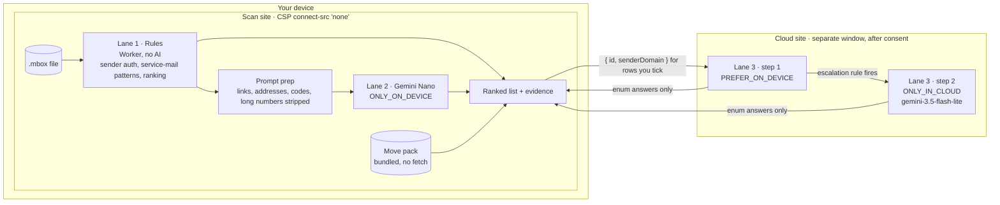

# Leave a Map

**Your school email has a shutoff date. Leave a Map reads your mailbox on your own device and ranks the accounts tied to that address, so you move the ones that matter before you're locked out.**

Built for #BuildHybridAI 2026 with Firebase AI Logic: Gemini Nano on the device for your mail, and a Gemini cloud model only for the web addresses you approve.

- **Try it:** https://leave-a-map.web.app. No login is needed: click **Try the sample**.
- **Use it on your own mail:** export your school mailbox as an `.mbox` file and pick it on the start screen.
- **For adults (18+) only.** The Gemini API terms don't allow apps aimed at under-18s. It's meant for graduates and alumni.

> **Status (24 Nov 2026):**
> - Lanes 1, 2 and 3 work end to end, and both sites are live with the current code.
> - **The hosted cloud lookup is live** on Gemini's paid tier, with App Check (reCAPTCHA Enterprise) enforced. A click-through on the live sites got answers back on 24 Nov. Hosting and AI Logic are on separate Firebase projects; only the cloud site talks to AI Logic.
> - Every result marked *pending* below is filled in from the pre-registered evaluation, including bad results.

## The problem

Universities close graduates' school email on a fixed date:

- One US university's alumni address service [ends on 31 Jan 2027](https://alumni.duke.edu/benefits-services).
- Another [deletes the class of 2026's school accounts on 31 Mar 2027](https://services.northwestern.edu/TDClient/30/Portal/KB/Article/2658/Google-Workspace-FAQ-for-Alumni), about 300 days after graduation.

Four years of sign-ups use that address. Some breakages are obvious and some aren't:

- **Accounts opened with "sign in with your school account"** have no password of their own. They stop working the day the address does.
- **Accounts that hold your work** lose their password reset: a code host with your thesis, a LaTeX editor, a document editor.
- **Accounts that can reset everything else** stop being recoverable: a password manager, or a personal mailbox whose recovery address is the school one.
- **Money:** banks, cards and subscriptions keep billing an address nobody reads.

Nobody remembers every account they made. The evidence is in the mailbox: welcome emails, receipts, security alerts. But a mailbox is about the most private thing a person owns, so it should never leave the device.

### The baseline: what already exists

[find my accounts](https://lorcanj.github.io/find-my-accounts/) is a free, open-source tool that reads an mbox locally, matches senders against a public list and links to deletion pages. It's good, and we treat it as the baseline.

Leave a Map is built for the shutoff date instead. It:

- ranks what breaks first;
- finds accounts opened with your school login;
- shows the quote from your own email behind every claim;
- uses on-device AI for what rules can't place;
- adds a consented cloud lookup only for services neither the rules nor the device know.

We read its public description only and copied no code (it's GPL-3.0; this repo is Apache-2.0).

## What it does

1. **Enter your school address and its shutoff date, then pick the `.mbox` file.** It's read in a Worker on a page that isn't allowed to make network requests.
2. **Get the list of what breaks on that date,** in the order to fix it:
   1. You sign in with your school account
   2. Holds your work
   3. Can reset your other accounts
   4. Money
   5. Everything else tied to the address
3. **Every card says why it's there:** a tier (**Seen**, **Likely** or **Possible**), the source (rules, on-device AI, cloud AI, the service list or you), and the exact quote and date from your mail.
4. **Fake-looking mail is set aside.** That covers failed sender checks and lookalike domains. **Mail forwarded in from another address** goes in its own section.
5. **A guided school-login step** opens your school account's connected-apps page. It warns you to add a password, or change the login email at the service, *before* you disconnect it.
6. **Move links:**
   - From a dated list of public sources, plus links a person opened and checked.
   - No model ever supplies a URL.
   - Without a checked link, the card says "open the service → account settings".
7. **A "Moved" checklist** with a counter. It's kept only in this browser.

## How it works: three lanes



| Lane | What it does | Where it runs | What it sees |
|---|---|---|---|
| **1. Rules** | Splits the mailbox, checks sender authentication, matches service-mail patterns and school-login notices, flags lookalikes, ranks | The browser, in a Worker. No AI | Your whole mailbox, on a page that can't connect anywhere |
| **2. Gemini Nano** | Labels one cleaned email per account: is it an account, what kind, what it holds, with a quote copied from the email | **On-device only** (`InferenceMode.ONLY_ON_DEVICE`) | At most 1,200 characters of cleaned text, which never leave the device |
| **3. Service lookup** | For services the rules and the move pack don't know: what kind of service it is, what it usually holds, and where its login-email setting usually is | **A cascade:** `PREFER_ON_DEVICE` first, then `ONLY_IN_CLOUD` only when a rule says the first answer isn't good enough. It runs on the cloud site, after you tick each row | **Only the web addresses you approve.** Never your mail. Answers are fixed categories, never links |

### Where `firebase/ai` is called

| File | Call | Notes |
|---|---|---|
| [`apps/scan/src/nano.ts`](apps/scan/src/nano.ts) | `getGenerativeModel(ai, { mode: InferenceMode.ONLY_ON_DEVICE, … })` | **Lane 2.** The Firebase config is a placeholder, so the scan site holds no real project. The model is never built unless `LanguageModel` exists; this guards against [firebase-js-sdk#10635](https://github.com/firebase/firebase-js-sdk/issues/10635), where on-device-only mode could fall back to the cloud. Every answer's `inferenceSource` is checked, and anything that isn't `on_device` throws |
| [`apps/cloud/src/egress.ts`](apps/cloud/src/egress.ts) | `getGenerativeModel(ai, { mode: InferenceMode.PREFER_ON_DEVICE, … })` and `getGenerativeModel(ai, { mode: InferenceMode.ONLY_IN_CLOUD, … })` | **Lane 3**, the only code that sends anything to a cloud model. Firebase and App Check (reCAPTCHA Enterprise) load only after the consent click. Both modes share one enum schema. Each field records which model answered it |
| [`apps/cloud/src/main.ts`](apps/cloud/src/main.ts) | `ONLY_IN_CLOUD` | Smoke test from the project setup (`smoke.html`). Built only with `--mode check`, never deployed |

**Escalation rules** ([`packages/core/cascade.ts`](packages/core/cascade.ts)) send a domain on to the cloud when the first answer:

- is invalid;
- says "not recognised";
- says "other";
- or leaves a field blank.


The merge keeps each field's source, so a card can say "on-device" for one line and "cloud" for another.

### Evidence that keeps AI honest

[`packages/core/evidence.ts`](packages/core/evidence.ts) caps every source:

- **Rules on authenticated mail** can say **Seen**.
- **AI can never say Seen.**
  - Nano reaches **Likely** only with a quote copied exactly from the email. Otherwise it stays at **Possible**.
  - A lane 3 answer describes the *kind* of service, so it never creates an account. It reaches **Likely** only when the mail already shows the account and the model says it recognises the service. A name-only guess stays **Possible**.
- **The move pack** follows the same caps as lane 3.

## Privacy: the claim and how we tested it

> **While Leave a Map reads your mailbox, the page that reads it makes no network requests.** The only thing that can ever leave is a sender's web address, and only after you tick it in a separate consent window on a second site.

That's the whole claim. It doesn't cover your browser's own background traffic, or the second site after you approve a lookup. Full details are in [`docs/PRIVACY.md`](docs/PRIVACY.md). In short:

- **Scan-site CSP:**
  - `default-src 'none'; connect-src 'none'`;
  - no frames, objects or form posts;
  - Trusted Types required;
  - no reporting endpoint.
- **[`lockdown.ts`](apps/scan/src/lockdown.ts) runs first.** CSP has no working WebRTC rule, so it:
  - deletes the WebRTC constructors;
  - refuses to create frame-like elements, which could bring back a fresh copy of WebRTC;
  - lets `window.open` reach only other sites.
- **Tested on 21 Nov 2026** with Chrome's own network log and a fake STUN listener, during a full sample scan plus on-device labelling:
  - **0 requests** from the scan page;
  - **0 WebRTC packets**.
  - A control page proved both checks catch traffic when there is some.
- **On-screen receipt:** the map screen lists every blocked attempt, every handoff and every answer, all logged on the page.

**Consent ([`apps/cloud/consent.html`](apps/cloud/consent.html)):**

- Every box starts unticked.
- "Select all except health and money" leaves sensitive rows for their own tick.
- An 18+ box is required.
- Unticked rows are discarded in the window.
- The window describes the terms of the Gemini tier the site runs on. On the paid tier, Google keeps requests for a limited time. On the free tier, Google may use requests to improve its products and people may read them. We never say "nothing is kept".
- On the free tier, the window also requires a "not in the EEA, Switzerland or the UK" box, never sends health or money rows, and looks up at most 10 services at a time.
- Pre-ticked boxes aren't consent, per GDPR Recital 32 and the CJEU's [*Planet49*](https://eur-lex.europa.eu/legal-content/EN/TXT/?uri=CELEX:62017CJ0673) judgment (C-673/17).

## Measured numbers

| What | Result | How | When |
|---|---|---|---|
| Large mailbox import | **4 GB in 15 s, peak memory 245 MB** | `npm run stress` | 21 Nov 2026 |
| Sample scan (55 emails) | **27 ms** | `tools/capture-test.mjs` | 21 Nov 2026 |
| Nano labelling, 60 fictional services, under the scan CSP | **60 of 60 labelled, median 897 ms, 0% invalid, all on-device** | Nano machine: Ubuntu, Chrome 158, GPU | 21 Nov 2026 |
| Nano labelling during the privacy test | **21 of 21 on-device, median 841 ms** | `tools/capture-test.mjs` | 21 Nov 2026 |
| Network requests from the scan page in a full run | **0** | Chrome net log, by network isolation key | 21 Nov 2026 |
| Two-site handoff on the live sites | **3 sent, 2 ticked, 2 answers back, 0 requests from the scan page** | `#handoff-check` | 21 Nov 2026 |
| Rules alone vs rules + Nano on real mailboxes | *pending* | [`docs/EVAL.md`](docs/EVAL.md), pre-registered at commit `03b3f2a` before any run | – |
| Lane 3 cascade from a production build, real App Check (no debug token), no Nano in the browser | **3 of 3 held-out sites answered in the cloud, all valid, 0.75–2.2 s each** | `cascade-check.html` (check build, not deployed), on `localhost` | 24 Nov 2026 |
| Lane 3 on the live sites, App Check enforced | **Answers sent back to the scan page** | Click-through on the hosted sites | 24 Nov 2026 |
| Hosted run of all three lanes on a Nano machine, with per-field sources | *pending* | T32 | – |

### Evaluation (pre-registered)

[`docs/EVAL.md`](docs/EVAL.md) fixed the thresholds, metrics and table at commit `03b3f2a`, before any real mailbox was scanned in eval mode:

- **Nano counts as helping** only if it adds at least 10% more true accounts than the rules alone, with precision dropping no more than 5 points.
- **The "holds" tag counts as reliable** only at 80% or better, on at least 30 accounts.

Owners label their own mail on their own machines in eval mode (`?eval=1`), and only counts are shared. Every row will be published here, bad ones included.

*Results: pending.*

Known issues, recorded before the run:

- Nano over-labels "work".
- Nano claims to recognise services that don't exist.

## Limits

- **Chrome on desktop with Gemini Nano** for lane 2. Elsewhere a banner says so, and lanes 1 and 3 still run.
- **`.mbox` only.** The common export formats are tested.
- **English-only patterns** and prompts.
- **One cloud model** (`gemini-3.5-flash-lite`), and the cloud lookup needs App Check.
- **Lane 3 knows services, not you.** It describes what a kind of service usually holds, never what your account holds.
- **Fictional services:** neither model can recognise one, so they're answered honestly as "not recognised".
- **The school-login page can be incomplete.** Schools can hide apps, so the list from your school account's page may be partial.
- **We don't protect against a malicious build of this app.** The code is public so anyone can check it.

## Run it

```bash
npm install
npm test
npm run dev
```

Open the printed local address and click **Try the sample**, or enter a school address and shutoff date and pick an `.mbox` file.

- **Cloud site (lane 3):** copy `.env.example` to `.env`, fill in your Firebase web app and reCAPTCHA Enterprise site key, then run `npm run dev:cloud`.
- **Production builds look nothing up** unless built with `VITE_CLOUD_LOOKUP` set:
  - `paid-tier-on` once the project is on Gemini's paid tier. The consent window describes the paid terms.
  - `free-tier-on` on the free tier. The consent window describes the free terms and adds the free-tier limits above.
  - Unset, the scan site doesn't offer the lookup and the consent window refuses it.
- **Local testing without reCAPTCHA:** put an App Check debug token in the git-ignored `.env.debug` and run `npm run dev:cloud -- --mode debug`. Production builds ignore it.
- **Build both sites:** `npm run build`. This writes `dist/scan` and `dist/cloud`.
- **Rebuild the move pack** from downloaded snapshots: `node tools/build-pack.ts <dir> data/pack-snapshot.json`.

## Repository layout

| Path | What |
|---|---|
| `apps/scan` | Site 1: import, rules, Nano, the list. No network access |
| `apps/cloud` | Site 2: consent window and the lane 3 cascade |
| `packages/core` | Pure TypeScript: mbox splitter, rules, evidence caps, ranking, contracts, cascade, move pack |
| `data` | Move pack snapshot and hand-checked links |
| `fixtures` | The fictional sample mailbox and its golden file |
| `docs` | [`PRIVACY.md`](docs/PRIVACY.md), [`EVAL.md`](docs/EVAL.md) |
| `tests/unit` | Vitest tests |
| `tools` | Fixture, sample, pack, stress and capture tools |

## What we reused

Everything else was written for this hackathon. The repository's first commit is 21 Nov 2026.

- **Packages:**
  - `firebase` (Apache-2.0), including Firebase AI Logic and App Check;
  - `postal-mime` (MIT-0) for bodies;
  - `tldts` (MIT) for registrable domains;
  - `preact`, `vite` and `vitest` (MIT);
  - `typescript` (Apache-2.0).
- **Data for the move pack**, a dated snapshot with credits in [`NOTICE.md`](NOTICE.md):
  - 2FA Directory (MIT);
  - the Passkeys directory (CC BY 4.0);
  - JustDeleteMe (MIT).
- **The sample mailbox** is fictional (`.example` domains, RFC 2606), apart from three real non-profit research sites. Their emails are made up, and the sites are there only so the cloud lookup has something real to recognise. We have no affiliation with them.

## Licence

Apache-2.0. See [`LICENSE`](LICENSE) and [`NOTICE.md`](NOTICE.md).
